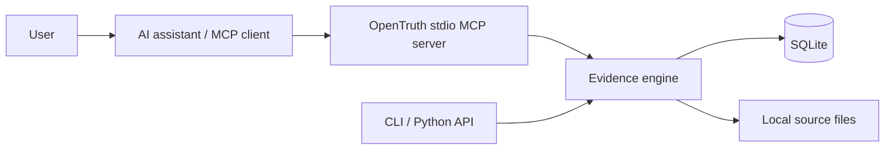

# OpenTruth

**Make AI Knowledge Verifiable.**

OpenTruth is a local-first evidence memory and verification toolkit for AI assistants,
researchers, and engineers. It records claims, sources, explicit evidence relationships,
reviews, and deterministic numerical conflict candidates in SQLite. It works offline,
without an LLM, cloud account, or external database.

A stored assertion is not necessarily true. A registered source is not necessarily reliable.
A citation is not proof. OpenTruth manages evidence; it does not determine scientific truth.

## Capabilities

- Preserve exact statements and every revision, with attributed audit events.
- Register bibliographic metadata and copy bounded workspace-local files with SHA-256.
- Explicit SUPPORTS, CONTRADICTS, RELATED, and INCONCLUSIVE relationships.
- Keyword/phrase search, subject/property/review filters, evidence inspection, JSON export.
- Conservative numeric comparison with context, units, and configurable tolerances.
- Shared Python API, JSON CLI, and nine tools through the official MCP SDK (stdio).

## Architecture



## Install from source

Python 3.11+ is required. No PyPI release is claimed.

```sh
git clone https://github.com/fredsevmartins/OpenTruth.git
cd OpenTruth
python -m venv .venv
. .venv/bin/activate
python -m pip install -e ".[dev]"
opentruth init
```

## First evidence workflow

```python
from opentruth import OpenTruth

app = OpenTruth(".")
claim = app.add_claim("SYNTHETIC: Alloy Q withstands 10 cycles.", provenance={"synthetic": True})
source = app.register_source("SYNTHETIC laboratory notebook", source_type="EXPERIMENT")
app.link_evidence(
    claim["id"],
    source["id"],
    "SUPPORTS",
    "table 1",
    "SYNTHETIC: 10 observed cycles",
    "synthetic demonstrator",
)
print(app.inspect_claim(claim["id"])["evidence_status"])
# SUPPORTED_BY_REGISTERED_EVIDENCE — not independently verified
app.close()
```

CLI equivalent for creating and listing claims:

```sh
opentruth claim add --json '{"original_statement":"SYNTHETIC: Alloy Q withstands 10 cycles."}'
opentruth claim list --json '{"query":"Alloy"}'
opentruth export > evidence.json
```

## MCP integration

Run `opentruth --workspace /absolute/allowed/workspace mcp` with a client that launches
local stdio servers. See [integration and client limits](docs/mcp-integration.md).
Do not assume ChatGPT can launch a local stdio process.

## Examples, conflict detection, and history

Run `python -m examples.scenarios` for four entirely synthetic, assertion-checked scenarios:
pharmacokinetic contexts, changing evidence, unsupported AI assertions, and engineering units.
See [examples](docs/examples.md) and [comparison rules](docs/conflict-detection.md).
Different values alone never establish a contradiction. Context equality is an explicit,
limited comparison policy, not proof that all scientific confounders were captured.
`get_claim_history()` preserves creation, revisions, evidence changes, reviews, and comparisons.

## Development checks

```sh
python -m pytest
ruff check .
python -m build
python -m examples.scenarios
```

Tests include a real SDK MCP client/server stdio session. GitHub Actions checks tests,
linting, package builds, MCP integration, and examples on Python 3.11–3.13.

## Documentation and figures

Start with [installation](docs/installation.md), [quickstart](docs/quickstart.md),
[architecture](docs/architecture.md), [Python API](docs/python-api.md),
[CLI](docs/cli-reference.md), and [scientific integrity](docs/scientific-integrity.md).
Six Mermaid figures are in [docs/workflows](docs/workflows).

## Limitations and roadmap

v0.1 implements evidence memory, not semantic understanding, independent source verification,
DOI fetching, authentication, or multi-user access control. JSON exports contain metadata and
file references, not source bytes. See [limitations](docs/limitations.md) and [security](SECURITY.md).

Planned only: v0.2 optional assisted extraction and confirmation; v0.3 semantic search,
local embeddings, evidence visualization, source versions, and batch exchange; v0.4
JSON-LD/PROV interoperability and scientific repository integration; v0.5 collaborative
reviews and access control; v1.0 stable evidence exchange and extensible validation.
All future AI assistance remains optional and distinguished from deterministic/human checks.

## Contributing, citation, and license

See [CONTRIBUTING.md](CONTRIBUTING.md), [Code of Conduct](CODE_OF_CONDUCT.md),
[CITATION.cff](CITATION.cff), and the [MIT license](LICENSE).
