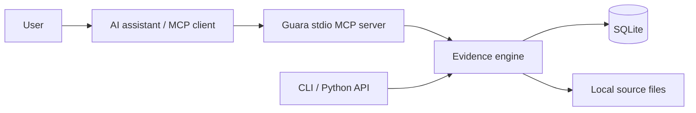

# Guara

**Make AI Knowledge Verifiable.**

Formerly OpenTruth. The Python package, CLI command, and `.opentruth/` storage name remain
`opentruth` for compatibility. The project and repository are now named **Guara**.
See [compatibility details](docs/repository-name.md).

[Start here / Comece aqui](COMECE-AQUI.md) · [Documentation](docs/README.md) · [Português brasileiro](docs/pt-BR/README.md) · [Quickstart](docs/quickstart.md) · [Contributing](CONTRIBUTING.md)

## What is Guara?

Guara is a local-first evidence memory and verification toolkit for AI assistants,
researchers, and engineers. It records claims, sources, explicit evidence relationships,
reviews, and deterministic numerical conflict candidates in SQLite. It works offline,
without an LLM, cloud account, or external database.

A stored assertion is not necessarily true. A registered source is not necessarily reliable.
A citation is not proof. Guara manages evidence; it does not determine scientific truth.

## Why evidence memory matters

An assistant's answer can outlive the sources and assumptions behind it. Exact wording, explicit
source relationships, and review history let users inspect why a statement was recorded and how
its evidence changed, without treating a saved answer as an established fact.

## Capabilities

- Preserve exact statements and every revision, with attributed audit events.
- Register bibliographic metadata and copy bounded workspace-local files with SHA-256.
- Explicit SUPPORTS, CONTRADICTS, RELATED, and INCONCLUSIVE relationships.
- Keyword/phrase search, subject/property/review filters, evidence inspection, JSON export.
- Conservative numeric comparison with context, units, and configurable tolerances.
- Shared Python API, JSON CLI, and twelve tools through the official MCP SDK (stdio).
- Verified-byte source checks, portable backup/restore, and paginated access.
- Auditable claim/evidence reassessment and serialized cooperating CLI/MCP operations.

## Architecture



## Install a release

Download the wheel or complete ZIP from [GitHub Releases](https://github.com/fredsevmartins/Guara/releases).
In an activated Python 3.11+ virtual environment:

```sh
python -m pip install /path/to/opentruth-0.1.3-py3-none-any.whl
opentruth --version
```

The ZIP includes the wheel, source distribution, documentation, synthetic tutorial, and mascot.
Release downloads include `SHA256SUMS`; see [release verification](docs/releasing.md).
The initial installation downloads Python dependencies. Installed local operations work offline.

## Install from source

Python 3.11+ is required. No PyPI release is claimed.

```sh
git clone https://github.com/fredsevmartins/Guara.git
cd Guara
python -m venv .venv
. .venv/bin/activate
python -m pip install -e ".[dev]"
opentruth init
```

## Quick start

Run this example from an authorized workspace after installation. It creates local data in
`.opentruth/`. All demonstration measurements are synthetic. For a complete workflow, including
reassessment and backup restoration, run `python -m examples.tutorial` from the checkout root.

```python
from opentruth import OpenTruth

app = OpenTruth(".")
claim = app.add_claim("SYNTHETIC: Alloy Q withstands 10 cycles.", provenance={"synthetic": True})
source = app.register_source("SYNTHETIC laboratory notebook", source_type="EXPERIMENT")
app.link_evidence(
    claim["id"],
    source["id"],
    "SUPPORTS",
    "table 1",
    "SYNTHETIC: 10 observed cycles",
    "synthetic demonstrator",
)
print(app.inspect_claim(claim["id"])["evidence_status"])
# SUPPORTED_BY_REGISTERED_EVIDENCE — not independently verified
app.close()
```

CLI equivalent for creating and listing claims:

```sh
opentruth claim add --json '{"original_statement":"SYNTHETIC: Alloy Q withstands 10 cycles."}'
opentruth claim list --json '{"query":"Alloy"}'
opentruth export > evidence.json
```

## MCP integration

Run `opentruth --workspace /absolute/allowed/workspace mcp` with a client that launches
local stdio servers. See [integration and client limits](docs/mcp-integration.md).
Do not assume ChatGPT can launch a local stdio process.

## Scientific examples

Run `python -m examples.scenarios` for four entirely synthetic, assertion-checked scenarios:
pharmacokinetic contexts, changing evidence, unsupported AI assertions, and engineering units.
See [examples](docs/examples.md) and [comparison rules](docs/conflict-detection.md).
Different values alone never establish a contradiction. Context equality is an explicit,
limited comparison policy, not proof that all scientific confounders were captured.

## Conflict detection

`check_conflicts(claim_id, abs_tol=0, rel_tol=1e-9)` compares numerical claims with the same subject,
property, and explicit context. Supported conversions cover time, length, and mass. Results explain
agreement, potential conflict, insufficient comparability, or why evaluation was not performed.
Comparison records preserve actual inputs; no semantic contradiction inference is performed.

## Knowledge history

`get_claim_history()` preserves creation, revisions, evidence changes, reviews, and comparisons.
Revising a claim preserves its original versions and requires reassessment of evidence before
earlier links contribute to the revised claim's summary. Human review and evidence status remain
separate. See the [evidence model](docs/evidence-model.md).

## Development checks

```sh
python -m pytest
ruff check .
python -m build
python scripts/check_docs.py
python scripts/prepare_release.py
python -m examples.scenarios
```

Tests include a real SDK MCP client/server stdio session. GitHub Actions checks tests,
linting, package builds, MCP integration, and examples on Python 3.11–3.13.

## Documentation and figures

Start with [installation](docs/installation.md), [quickstart](docs/quickstart.md),
[architecture](docs/architecture.md), [Python API](docs/python-api.md),
[CLI](docs/cli-reference.md), and [scientific integrity](docs/scientific-integrity.md).
Six Mermaid figures are in [docs/workflows](docs/workflows).

## Limitations

v0.1 implements evidence memory, not semantic understanding, independent source verification,
DOI fetching, authentication, or multi-user access control. JSON exports contain metadata and
file references, not source bytes. See [limitations](docs/limitations.md) and [security](SECURITY.md).

## Backups, integrity, and larger stores

```sh
opentruth --format text claim list --limit 100 --offset 0
opentruth source verify
opentruth backup snapshot.zip
opentruth restore snapshot.zip --data-dir restored-evidence
opentruth context templates engineering
```

Backups include a consistent SQLite snapshot and registered source files; JSON exports contain
metadata and references only. Restore validates bytes and requires an absent destination directory.
Byte integrity does not validate scientific content. Secure local source ingestion is POSIX-only;
Windows supports metadata workflows.

Search and conflict checks default to 100 results, with a maximum page size of 1000. Search omits
history by default. Use `--include-history`, inspect a claim, or paginate history when needed.
Cooperating CLI/MCP processes serialize operations and return `WORKSPACE_BUSY` on timeout.
Back up before upgrading: schema 1 migrates to schema 2 while retaining historical evidence.

See [backup and integrity](docs/backup-and-integrity.md), [scaling and concurrency](docs/scaling-and-concurrency.md),
[context templates](docs/context-templates.md), and [platform support](docs/platforms-and-releases.md).
The current package version is **0.1.3**; see the [release notes](docs/releases/v0.1.3.md).
PyPI publication is optional maintainer configuration and has not been confirmed.

## Meet Guará


Guará is our maned wolf mascot, inspired by Brazil's fauna. His notebook and magnifying glass
represent curiosity, traceability, and careful examination. He invites you to inspect evidence;
he does not certify that a claim is true. See the [mascot guide](docs/mascot.md) and [English LinkedIn artwork](docs/media.md).

## Roadmap

Planned only: v0.2 optional assisted extraction and confirmation; v0.3 semantic search,
local embeddings, evidence visualization, source versions, and batch exchange; v0.4
JSON-LD/PROV interoperability and scientific repository integration; v0.5 collaborative
reviews and access control; v1.0 stable evidence exchange and extensible validation.
All future AI assistance remains optional and distinguished from deterministic/human checks.

## Contributing

See [CONTRIBUTING.md](CONTRIBUTING.md), [Code of Conduct](CODE_OF_CONDUCT.md), and the
[issue templates](.github/ISSUE_TEMPLATE). Comparison-rule proposals should include scientific
assumptions and boundary tests.

## Citation

DOI: [10.5281/zenodo.23870405](https://doi.org/10.5281/zenodo.23870405).
Use [CITATION.cff](CITATION.cff) and cite the version used. Recording evidence with Guara
does not independently validate that evidence.

## License

Guara is available under the [MIT license](LICENSE).
