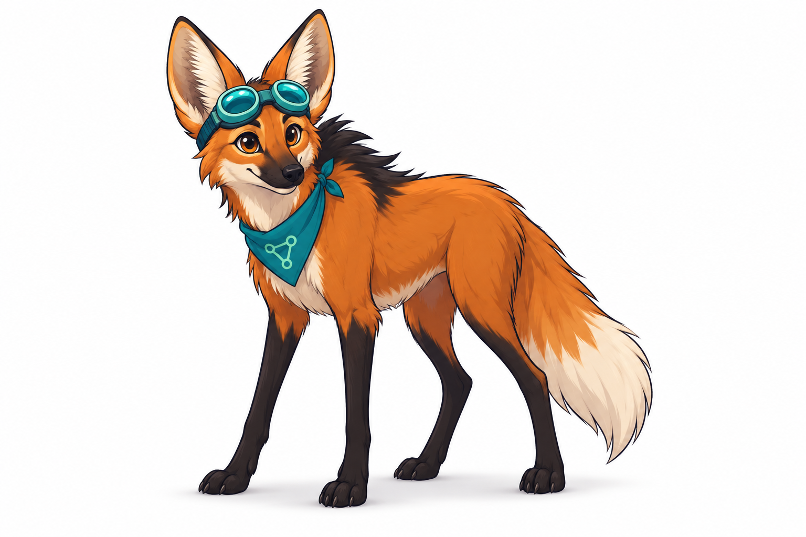

# Guará — the Guara mascot

**Guará** is an original mascot inspired by the Brazilian maned wolf (*Chrysocyon brachyurus*),
known in Portuguese as the **lobo-guará**. The character brings a Brazilian identity to
Guara while expressing curiosity, patience, and attention to evidence.

## Visual identity

Keep the long slender dark legs, rust-orange fur, large upright ears, black mane, pale throat,
and white-tipped tail recognizable. The illustration uses burnt orange, charcoal, cream, and
teal accents. The notebook represents preserved evidence and provenance; the magnifying glass
represents inspection.

Guará is a curious investigator. Avoid imagery suggesting an automatic truth verdict, such as
certification seals or a checkmark that declares a claim scientifically verified.

## Use in the project

The canonical artwork is [assets/mascot-guara.png](../assets/mascot-guara.png), a PNG with a
transparent background. Use it in the README, documentation, onboarding, and community materials.
Keep its aspect ratio and leave space around the full silhouette. Use the existing
[logo](../assets/logo.svg) where a simpler mark is needed; Guará complements that mark.

The [social artwork](media.md) includes a scientist variant with a white lab coat, teal goggles,
and bold cartoon outlines. The character remains a maned wolf.

Suggested display width: 240–360 pixels in documentation. For small placements, check that the
ears and long legs remain legible. Add descriptive alternative text, for example:

> Guará, a Brazilian maned wolf, examines an evidence notebook with a magnifying glass.

Portuguese alternative text:

> Guará, um lobo-guará, examina um caderno de evidências com uma lupa.

The artwork was generated with AI for this project. It is included under the project's
[MIT license](../LICENSE). This is a stylized character, not a zoological reference illustration.
